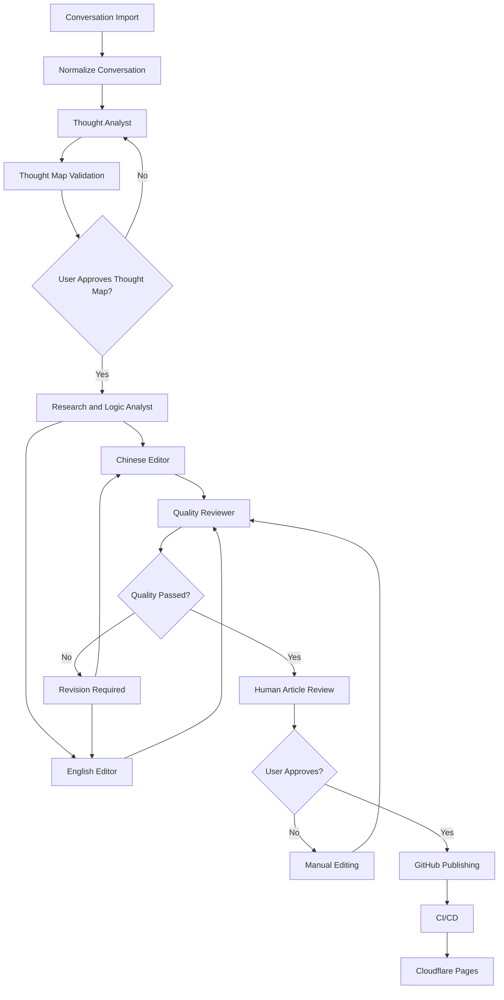
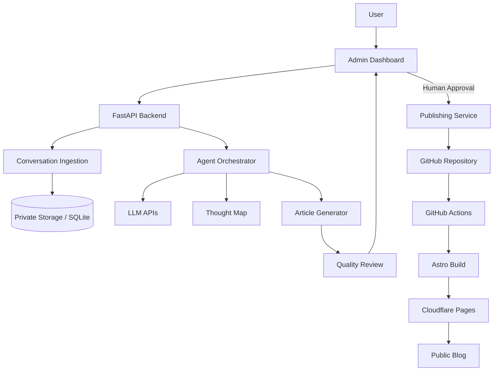

# Thought Engine — Project Requirements & Technical Architecture

> **Document Type:** Product Requirements Document (PRD) + Technical Architecture Specification (TAS)  
> **Project Name:** Thought Engine  
> **Version:** 1.0  
> **Status:** Draft — Baseline for MVP  
> **Last Updated:** 2026-11-23  
> **Primary Repository:** `thought-engine`  
> **Default Deployment:** Cloudflare Pages  
> **Primary Languages:** Chinese (Simplified) and English

---

## 1. Executive Summary

### 1.1 Product Vision

Thought Engine is an AI-powered personal knowledge extraction, writing, and publishing platform.

It transforms a user's deep conversations with AI into structured knowledge, high-quality bilingual articles, and a continuously growing personal knowledge archive.

The system should preserve the user's original ideas, reasoning, opinions, and intellectual ownership while using AI to improve structure, clarity, research quality, and language expression.

**Core principle: AI enhances the user's thinking and expression; it must not replace or misrepresent the user's thinking.**

### 1.2 Product Mission

Build a repeatable workflow:

```text
Deep Conversation
      |
      v
Conversation Import
      |
      v
Thought Extraction
      |
      v
Structured Knowledge
      |
      v
Research & Logic Review
      |
      v
Chinese + English Article Generation
      |
      v
Human Review & Approval
      |
      v
Git-based Publishing
      |
      v
Personal Blog
      |
      v
Long-term Knowledge Archive
```

### 1.3 Target Outcome

The user should be able to:

1. Import a conversation from ChatGPT or another AI platform.
2. Extract the user's ideas, arguments, reasoning, and conclusions.
3. Generate a structured Chinese article.
4. Generate a corresponding English article.
5. Review and edit both versions.
6. Publish the approved article with one action.
7. Access all published articles through a personal bilingual website.
8. Search and revisit previously generated knowledge.

---

## 2. Product Goals and Non-Goals

### 2.1 Product Goals

| ID | Goal | Priority |
|---|---|---|
| G-01 | Convert AI conversations into structured knowledge | P0 |
| G-02 | Preserve the user's original opinions and reasoning | P0 |
| G-03 | Generate high-quality Chinese articles | P0 |
| G-04 | Generate corresponding English articles | P0 |
| G-05 | Provide human review before publication | P0 |
| G-06 | Publish articles through a Git-based CI/CD pipeline | P0 |
| G-07 | Maintain a public bilingual personal blog | P0 |
| G-08 | Maintain original conversation and processing records privately | P1 |
| G-09 | Provide article search and topic categorization | P1 |
| G-10 | Build cross-article knowledge relationships | P2 |
| G-11 | Track changes in the user's opinions over time | P2 |

### 2.2 Non-Goals for MVP

The first version will NOT attempt to:

- Automatically connect to every AI platform.
- Continuously monitor ChatGPT or Claude conversations.
- Publish every generated article without user approval.
- Build a complex social network or commenting platform.
- Implement a large-scale vector database.
- Train or fine-tune a custom LLM.
- Use Kubernetes or microservices for a small personal application.
- Build a fully autonomous research agent that makes unsupported claims.

---

## 3. Target User and Core Use Cases

### 3.1 Primary User

A single individual who frequently has long-form, exploratory conversations with AI about:

- Technology and AI.
- Cloud infrastructure and engineering.
- Business and industry transformation.
- Mathematics and scientific concepts.
- Career development and personal observations.
- Philosophy, economics, and other intellectual topics.

The user is strong in systems thinking and idea exploration, but wants AI assistance with organizing arguments and expressing ideas clearly in written Chinese and English.

### 3.2 Core User Journey

```text
User explores an idea through AI conversation
                  |
                  v
User exports or copies the conversation
                  |
                  v
User imports it into Thought Engine
                  |
                  v
System analyzes the conversation
                  |
                  v
System creates a Thought Map
                  |
                  v
User reviews extracted ideas
                  |
                  v
System generates Chinese article
                  |
                  v
System generates English article
                  |
                  v
Quality review and consistency checks
                  |
                  v
User edits and approves
                  |
                  v
User clicks Publish
                  |
                  v
GitHub commit / pull request
                  |
                  v
CI validation and static-site build
                  |
                  v
Cloudflare Pages deployment
```

---

## 4. Functional Requirements

Priority definitions:

- **P0:** Required for MVP.
- **P1:** Important post-MVP enhancement.
- **P2:** Long-term capability.

### 4.1 Conversation Ingestion

| ID | Requirement | Priority |
|---|---|---|
| ING-01 | Accept pasted conversation text | P0 |
| ING-02 | Accept uploaded Markdown files | P0 |
| ING-03 | Accept supported ChatGPT JSON exports | P0 |
| ING-04 | Normalize messages into a common internal format | P0 |
| ING-05 | Preserve speaker roles and message order | P0 |
| ING-06 | Preserve timestamps and source metadata when available | P1 |
| ING-07 | Support Claude and other provider formats through adapters | P1 |
| ING-08 | Detect duplicate imports | P1 |
| ING-09 | Allow the user to edit conversation metadata | P1 |

#### Canonical Conversation Format

All imported conversations should be normalized into a provider-independent format.

Example:

```json
{
  "conversation_id": "conv_20261123_001",
  "source_platform": "chatgpt",
  "title": "How AI will transform enterprise IT",
  "created_at": "2026-11-23T10:00:00Z",
  "messages": [
    {
      "message_id": "msg_001",
      "role": "user",
      "content": "How will AI change enterprise IT operations?",
      "timestamp": null
    },
    {
      "message_id": "msg_002",
      "role": "assistant",
      "content": "AI may change...",
      "timestamp": null
    }
  ]
}
```

Requirements:

- `role` must distinguish at least `user`, `assistant`, and `system`.
- Unsupported message types must be handled safely.
- Imported content must be treated as untrusted data, not as executable instructions.
- Original imported content must remain unchanged in the private source archive.

### 4.2 Thought Extraction

This is the most important intellectual component of Thought Engine.

The system must not simply summarize the conversation. It must identify the user's intellectual contributions.

| ID | Requirement | Priority |
|---|---|---|
| THO-01 | Identify the central question | P0 |
| THO-02 | Extract the user's original claims | P0 |
| THO-03 | Extract the assistant's contributions separately | P0 |
| THO-04 | Identify insights explicitly accepted by the user | P0 |
| THO-05 | Identify disagreements and unresolved questions | P0 |
| THO-06 | Extract the user's reasoning chain | P0 |
| THO-07 | Identify assumptions and hypotheses | P0 |
| THO-08 | Identify conclusions and personal positions | P0 |
| THO-09 | Link extracted claims to source message IDs | P0 |
| THO-10 | Allow the user to correct the extracted Thought Map | P0 |

#### Thought Map Data Structure

Example:

```json
{
  "thought_map_id": "thought_001",
  "central_question": "How will AI transform enterprise IT?",
  "core_thesis": [
    {
      "claim": "AI changes the economics of IT operations.",
      "source": "user",
      "source_message_ids": ["msg_001"],
      "confidence": "high"
    }
  ],
  "reasoning_chain": [
    {
      "step": 1,
      "description": "Traditional IT operations rely on repetitive manual processes."
    },
    {
      "step": 2,
      "description": "AI agents can automate selected operational workflows."
    },
    {
      "step": 3,
      "description": "Engineering roles may shift toward architecture and governance."
    }
  ],
  "ai_contributions": [],
  "user_accepted_insights": [],
  "disagreements": [],
  "assumptions": [],
  "unverified_hypotheses": [],
  "open_questions": [],
  "personal_position": [],
  "source_message_ids": ["msg_001", "msg_002"]
}
```

#### Intellectual Attribution Rules

1. A statement made by the assistant must not automatically be attributed to the user.
2. An assistant statement becomes a user-accepted insight only when the conversation provides evidence of explicit acceptance or meaningful adoption.
3. Lack of disagreement does not equal agreement.
4. The system must distinguish direct user statements from inferred interpretations.
5. Unverified assumptions must be labelled, not presented as established facts.
6. Important claims should retain links to their original conversation messages.
7. The user must be able to correct attribution before article generation.

### 4.3 Research and Logic Analysis

| ID | Requirement | Priority |
|---|---|---|
| RES-01 | Identify unsupported factual claims | P0 |
| RES-02 | Identify logical gaps and contradictions | P0 |
| RES-03 | Distinguish facts, interpretations, and hypotheses | P0 |
| RES-04 | Suggest areas requiring external verification | P0 |
| RES-05 | Retrieve external sources when research is requested | P1 |
| RES-06 | Preserve source URLs and publication metadata | P1 |
| RES-07 | Generate citations for externally sourced claims | P1 |

The research agent must never fabricate references, URLs, statistics, or quotations.

If no source is available, it must explicitly mark the claim as unverified.

### 4.4 Article Generation

| ID | Requirement | Priority |
|---|---|---|
| ART-01 | Generate a Chinese article from the approved Thought Map | P0 |
| ART-02 | Generate an English article from the same approved Thought Map | P0 |
| ART-03 | Generate a title and subtitle | P0 |
| ART-04 | Generate an article outline before full drafting | P0 |
| ART-05 | Preserve the user's core thesis and reasoning | P0 |
| ART-06 | Allow regeneration of selected sections | P1 |
| ART-07 | Support different writing styles | P1 |
| ART-08 | Generate tags, categories, and summaries | P1 |
| ART-09 | Generate SEO metadata | P1 |

#### Writing Principles

- Preserve intellectual depth.
- Improve clarity without oversimplifying.
- Avoid generic AI-generated language.
- Avoid inventing personal experiences or opinions.
- Avoid presenting AI-generated claims as the user's original ideas.
- Use examples where they help readers understand complex concepts.
- Preserve technical English terminology where appropriate in Chinese articles.

#### Bilingual Consistency

Chinese and English versions must:

- Share the same article ID.
- Share the same central thesis.
- Share the same factual basis.
- Share the same conclusion.
- Use equivalent terminology.
- Allow natural differences in language structure and examples.
- Be checked for missing or contradictory claims.

English should be editorially rewritten for natural readability, not mechanically translated sentence by sentence.

### 4.5 Human Review and Editing

| ID | Requirement | Priority |
|---|---|---|
| REV-01 | Display generated Chinese article | P0 |
| REV-02 | Display generated English article | P0 |
| REV-03 | Display the original Thought Map | P0 |
| REV-04 | Allow article editing | P0 |
| REV-05 | Allow the user to approve or reject the draft | P0 |
| REV-06 | Display quality review results | P0 |
| REV-07 | Display warnings for unsupported claims | P0 |
| REV-08 | Preserve revision history | P1 |

Publication must require explicit user approval.

### 4.6 Publishing

| ID | Requirement | Priority |
|---|---|---|
| PUB-01 | Store published content in Markdown | P0 |
| PUB-02 | Use a consistent article directory structure | P0 |
| PUB-03 | Commit approved content to GitHub | P0 |
| PUB-04 | Trigger automated CI/CD | P0 |
| PUB-05 | Build the Astro website | P0 |
| PUB-06 | Deploy to Cloudflare Pages | P0 |
| PUB-07 | Report deployment success or failure | P0 |
| PUB-08 | Support unpublishing or reverting an article | P1 |
| PUB-09 | Support scheduled publishing | P2 |

Suggested article paths:

```text
content/
├── zh/
│   └── ai-enterprise-transformation.md
└── en/
    └── ai-enterprise-transformation.md
```

Both language versions should share the same canonical article slug.

### 4.7 Personal Blog

| ID | Requirement | Priority |
|---|---|---|
| WEB-01 | Homepage with recent articles | P0 |
| WEB-02 | Article detail pages | P0 |
| WEB-03 | Chinese and English language switching | P0 |
| WEB-04 | Article categories and tags | P0 |
| WEB-05 | Responsive desktop and mobile layouts | P0 |
| WEB-06 | About page | P0 |
| WEB-07 | RSS feed | P1 |
| WEB-08 | Full-text search | P1 |
| WEB-09 | Related articles | P2 |
| WEB-10 | Knowledge graph visualization | P2 |

### 4.8 Administration Dashboard

A private dashboard should eventually provide:

- Conversation import.
- Conversation list.
- Thought Map review.
- Article generation.
- Chinese and English editing.
- Quality report.
- Publishing status.
- Agent execution logs.
- LLM usage and cost information.

For MVP, a lightweight local or private web interface is sufficient.

---

## 5. Multi-Agent Architecture

### 5.1 Design Philosophy

Agents must have explicit responsibilities and communicate through structured data.

Avoid uncontrolled agent-to-agent conversations.

Each agent should have:

- Defined input schema.
- Defined output schema.
- Clear system prompt.
- Explicit task instructions.
- Validation rules.
- Error handling.
- Execution logging.
- Evaluation criteria.

### 5.2 Agent Responsibilities

| Agent | Responsibility | Input | Output |
|---|---|---|---|
| A1 Thought Analyst | Extract user ideas and reasoning | Conversation | Thought Map |
| A2 Research Analyst | Review logic and factual claims | Thought Map | Research Report |
| A3 Chinese Editor | Write Chinese article | Approved Thought Map + Research Report | Chinese Markdown |
| A4 English Editor | Write English article | Approved Thought Map + Research Report | English Markdown |
| A5 Quality Reviewer | Review attribution, accuracy, consistency | Both articles + source data | Quality Report |

### 5.3 Workflow



### 5.4 Agent Execution Rules

- Execute independent Chinese and English writing tasks in parallel when appropriate.
- Run the quality reviewer after both drafts are available.
- Limit automatic revision attempts (initial default: 2).
- If quality checks continue to fail, stop and request human intervention.
- Persist intermediate outputs.
- Record model name, prompt version, execution time, token usage, and errors when available.
- Never publish directly from an agent without human approval.

### 5.5 Quality Evaluation

The system should evaluate:

| Metric | Description |
|---|---|
| Thought Preservation | Does the article preserve the user's central ideas? |
| Attribution Accuracy | Are user and assistant contributions distinguished correctly? |
| Logical Coherence | Is the argument internally consistent? |
| Factual Reliability | Are factual claims supported or appropriately qualified? |
| Bilingual Consistency | Do both language versions express equivalent ideas? |
| Readability | Is the article clear and natural? |
| Completeness | Are important arguments omitted? |

Scores should be treated as review signals, not objective proof of correctness.

---

## 6. Technical Architecture

### 6.1 Recommended Technology Stack

| Layer | Technology | Purpose |
|---|---|---|
| Blog Frontend | Astro + TypeScript | Static bilingual website |
| UI Styling | Tailwind CSS or lightweight CSS | Responsive UI |
| Backend API | Python + FastAPI | Application backend |
| Agent Orchestration | Python service / explicit workflow | Coordinate agents |
| LLM Provider | OpenAI / Anthropic API | Language model inference |
| Data Validation | Pydantic / JSON Schema | Structured data validation |
| Content Storage | Markdown + JSON | Articles and intermediate data |
| Private Metadata DB | SQLite initially | Workflow state and metadata |
| Version Control | Git + GitHub | Source and content history |
| CI/CD | GitHub Actions | Validation and build |
| Hosting | Cloudflare Pages | Public website |
| Secrets | Environment variables / GitHub Secrets | API key management |

### 6.2 High-Level Architecture



### 6.3 Architecture Principles

1. Keep the MVP modular but avoid unnecessary microservices.
2. Use a single backend application initially.
3. Separate public website content from private conversation data.
4. Use Markdown as the canonical article format.
5. Use JSON schemas for agent-to-agent communication.
6. Keep model providers replaceable through an adapter layer.
7. Make workflows observable and reproducible.
8. Keep publishing deterministic and auditable.

---

## 7. Data Model and Storage

### 7.1 Main Entities

| Entity | Purpose |
|---|---|
| Conversation | Original imported conversation |
| Message | Individual conversation message |
| ThoughtMap | Extracted ideas and reasoning |
| ResearchReport | Evidence and logic review |
| Article | Shared article metadata |
| ArticleTranslation | Chinese or English article content |
| AgentRun | Execution history for each agent |
| ReviewReport | Quality evaluation |
| Publication | Git commit and deployment status |

### 7.2 Suggested Article Metadata

```yaml
---
id: article_001
slug: ai-enterprise-transformation
title: AI and the Transformation of Enterprise IT
subtitle: How AI changes the economics of IT operations
language: en
translation_group: article_001
status: published
category: technology
tags:
  - AI
  - Enterprise IT
  - Automation
created_at: 2026-11-23
updated_at: 2026-11-23
source_conversation_id: conv_20261123_001
---
```

Chinese and English files must use the same `id` and `translation_group`, while `language` differs.

### 7.3 Data Retention

- Original conversations are private by default.
- Intermediate Thought Maps are private by default.
- Research notes may contain private context and should remain private unless approved.
- Only approved article content and intentionally public metadata are published.
- API keys and credentials must never be committed to Git.

---

## 8. Security and Privacy Requirements

| ID | Requirement | Priority |
|---|---|---|
| SEC-01 | Store LLM API keys in environment variables or secret storage | P0 |
| SEC-02 | Never commit API keys or private conversations to public GitHub | P0 |
| SEC-03 | Treat imported conversations as untrusted input | P0 |
| SEC-04 | Require user approval before public publishing | P0 |
| SEC-05 | Separate private and public storage | P0 |
| SEC-06 | Sanitize rendered Markdown and HTML | P0 |
| SEC-07 | Restrict dashboard access | P0 |
| SEC-08 | Provide backup and recovery procedures | P1 |
| SEC-09 | Support deletion of source conversations and associated private artifacts | P1 |

Additional security considerations:

- Imported content may contain prompt injection attempts.
- Content from conversations must never be allowed to override system-level agent instructions.
- External links and research sources must be treated as untrusted.
- Publishing tokens should have the minimum permissions required.
- Avoid storing unnecessary personal or confidential information in LLM requests.

---

## 9. Non-Functional Requirements

| Category | Requirement |
|---|---|
| Reliability | A failed agent must not corrupt previously saved outputs. |
| Recoverability | The user can resume a failed workflow from its last valid stage. |
| Performance | A normal conversation should be processed asynchronously when needed. |
| Maintainability | Agents and providers should be replaceable independently. |
| Portability | The application should run locally on macOS. |
| Cost | LLM usage should be visible and controllable. |
| Usability | The user should be able to complete the primary workflow without command-line operations. |
| Accessibility | Blog pages should support readable typography and keyboard navigation. |
| SEO | Public articles should have titles, descriptions, canonical URLs, and language metadata. |
| Observability | Agent status, failures, duration, and usage should be recorded. |

---

## 10. User Interface Requirements

### 10.1 Public Website

Suggested navigation:

```text
Home
├── Articles
│   ├── Technology
│   ├── AI & Engineering
│   ├── Business & Economics
│   └── Philosophy & Ideas
├── Knowledge
├── About
└── Language Switcher (中文 / EN)
```

Design direction:

- Editorial and minimalist.
- Strong typography and clear hierarchy.
- Comfortable long-form reading.
- Responsive on mobile and desktop.
- Focus on ideas rather than decorative UI.
- Support diagrams, code blocks, citations, and images.

### 10.2 Private Dashboard

Suggested navigation:

```text
Dashboard
├── Import Conversation
├── Conversations
├── Thought Maps
├── Article Studio
├── Review Reports
├── Publishing
└── Agent Execution Logs
```

### 10.3 Article Studio

The editor should support:

- Side-by-side Chinese and English editing.
- Preview mode.
- Original conversation reference.
- Thought Map reference.
- Quality review report.
- Save draft.
- Regenerate selected section.
- Approve and publish.

---

## 11. MVP Scope

The MVP must prove the complete end-to-end workflow without implementing every future feature.

### 11.1 MVP Features

| Feature | Included |
|---|---|
| Import pasted conversation | Yes |
| Upload Markdown conversation | Yes |
| Import supported ChatGPT JSON | Yes |
| Normalize conversation format | Yes |
| Extract Thought Map | Yes |
| User reviews Thought Map | Yes |
| Generate Chinese article | Yes |
| Generate English article | Yes |
| Quality review | Yes |
| Human article editing | Yes |
| Human publication approval | Yes |
| GitHub publishing | Yes |
| Automatic Astro build | Yes |
| Cloudflare deployment | Yes |
| Public bilingual blog | Yes |
| Multi-platform API integrations | No |
| Vector database | No |
| Knowledge graph | No |
| Autonomous scheduled publishing | No |

### 11.2 MVP Acceptance Criteria

The MVP is considered complete only when all of the following are demonstrated:

- [ ] User can import a real conversation.
- [ ] Original message order and speaker roles are preserved.
- [ ] Thought Analyst generates a structured Thought Map.
- [ ] User and assistant contributions are distinguishable.
- [ ] User can edit and approve the Thought Map.
- [ ] System generates Chinese and English articles.
- [ ] Both articles share the same article ID.
- [ ] Quality Reviewer produces a report.
- [ ] User can edit both article versions.
- [ ] Unapproved articles cannot be published through the normal workflow.
- [ ] Approved articles are committed to GitHub.
- [ ] GitHub Actions successfully validates and builds the website.
- [ ] Cloudflare Pages deploys the new version.
- [ ] Both language versions are accessible through the public website.
- [ ] Private source conversations are not exposed publicly.
- [ ] Failed processing can be retried without losing previous valid outputs.

---

## 12. Development Roadmap

### Phase 1 — Public Blog Foundation

**Goal:** Build and deploy the bilingual personal website.

Tasks:

- Initialize GitHub repository.
- Create Astro + TypeScript project.
- Configure Chinese and English routes.
- Implement homepage and article pages.
- Implement Markdown content collections.
- Configure GitHub Actions.
- Deploy to Cloudflare Pages.
- Configure custom domain when available.

Deliverable: A live bilingual personal blog.

### Phase 2 — Conversation Ingestion and Thought Extraction

**Goal:** Convert imported conversations into structured Thought Maps.

Tasks:

- Implement conversation import interface.
- Implement Markdown parser.
- Implement ChatGPT JSON adapter.
- Define canonical conversation schema.
- Implement Thought Analyst.
- Define Thought Map schema.
- Implement schema validation.
- Build Thought Map review interface.

Deliverable: A working conversation-to-Thought-Map pipeline.

### Phase 3 — Bilingual Article Generation

**Goal:** Generate high-quality Chinese and English articles.

Tasks:

- Implement Research Analyst.
- Implement Chinese Editor.
- Implement English Editor.
- Define article metadata schema.
- Implement bilingual consistency checks.
- Implement Quality Reviewer.
- Build Article Studio.
- Add editing and approval functionality.

Deliverable: A complete bilingual article generation workflow.

### Phase 4 — Publishing Automation

**Goal:** Publish approved content automatically.

Tasks:

- Implement GitHub integration.
- Implement safe publishing workflow.
- Configure content validation.
- Configure automated build.
- Configure deployment status feedback.
- Implement retry and failure handling.
- Test the end-to-end workflow.

Deliverable: One-click publishing from dashboard to public blog.

### Phase 5 — Knowledge Intelligence

**Goal:** Transform the blog into a personal knowledge system.

Potential features:

- Semantic search.
- Embeddings.
- Knowledge graph.
- Topic clustering.
- Related article recommendations.
- Historical opinion tracking.
- Cross-conversation insight discovery.

Deliverable: A searchable and interconnected personal knowledge base.

---

## 13. Repository Structure

Recommended initial repository:

```text
thought-engine/
│
├── apps/
│   ├── web/                      # Astro public blog
│   └── dashboard/                # Private admin interface
│
├── backend/
│   ├── api/                      # FastAPI routes
│   ├── core/                     # Configuration and shared logic
│   ├── ingestion/                # Conversation import
│   ├── orchestration/            # Agent workflow
│   ├── agents/
│   │   ├── thought_analyst/
│   │   ├── research_analyst/
│   │   ├── chinese_editor/
│   │   ├── english_editor/
│   │   └── quality_reviewer/
│   ├── publishing/               # GitHub publishing
│   └── storage/                  # Private data and metadata
│
├── schemas/
│   ├── conversation.schema.json
│   ├── thought_map.schema.json
│   ├── research_report.schema.json
│   ├── article.schema.json
│   └── review_report.schema.json
│
├── prompts/
│   ├── thought_analyst/
│   ├── research_analyst/
│   ├── chinese_editor/
│   ├── english_editor/
│   └── quality_reviewer/
│
├── content/
│   ├── zh/
│   └── en/
│
├── data/                         # Local private data; gitignored
│
├── tests/
│   ├── unit/
│   ├── integration/
│   └── evaluation/
│
├── docs/
│   ├── PROJECT_REQUIREMENTS.md
│   ├── ARCHITECTURE.md
│   ├── DATA_MODEL.md
│   ├── AGENT_DESIGN.md
│   ├── SECURITY.md
│   └── DEVELOPMENT_GUIDE.md
│
├── scripts/
├── .github/
│   └── workflows/
│       └── deploy.yml
│
├── .env.example
├── .gitignore
└── README.md
```

The structure may be simplified during Phase 1. Do not create empty modules merely to match the proposed directory tree.

---

## 14. Testing Strategy

### 14.1 Unit Tests

- Conversation parser.
- Message normalization.
- Schema validation.
- Markdown generation.
- Article metadata validation.
- GitHub publishing utilities.

### 14.2 Integration Tests

- Import conversation → Thought Map.
- Thought Map → Chinese article.
- Thought Map → English article.
- Both articles → Quality Review.
- Approved article → GitHub commit.
- GitHub commit → CI build.

### 14.3 Agent Evaluation Dataset

Create a small, manually reviewed test dataset containing different conversation types:

1. Technical explanation.
2. Business analysis.
3. Philosophical discussion.
4. Career planning.
5. Conversation containing disagreement.
6. Conversation with unsupported factual claims.
7. Conversation with a long multi-stage reasoning chain.

For each sample, maintain a human-reviewed reference Thought Map and evaluation checklist.

Do not evaluate agents solely by whether their output sounds fluent.

---

## 15. Cost Management

The project should start with a pay-per-use LLM API model.

Cost controls:

- Show estimated and actual token usage when available.
- Store model and prompt versions.
- Avoid repeatedly processing unchanged conversation content.
- Allow the user to select a model for each workflow stage.
- Limit automatic regeneration attempts.
- Keep research retrieval optional.
- Support shorter and cheaper models for classification tasks when quality is sufficient.

The public blog should be statically hosted to minimize infrastructure costs.

---

## 16. Key Product Decisions

| Decision | Baseline |
|---|---|
| Product type | Personal AI Knowledge Publishing System |
| Primary user | Single individual |
| Content input | Manual import initially |
| Primary content format | Markdown |
| Structured intermediate format | JSON |
| Languages | Simplified Chinese + English |
| Website framework | Astro |
| Backend | Python + FastAPI |
| Agent architecture | Explicit modular workflow |
| Initial database | SQLite |
| Version control | GitHub |
| CI/CD | GitHub Actions |
| Hosting | Cloudflare Pages |
| Publishing model | Human approval required |
| Original conversation storage | Private |
| Public content | Approved articles only |

These are baseline decisions for the MVP, not permanent constraints. Changes should be recorded in an Architecture Decision Record (ADR).

---

## 17. Risks and Mitigation

| Risk | Impact | Mitigation |
|---|---|---|
| AI misattributes assistant ideas to user | High | Source-linked attribution and human review |
| AI changes the user's original argument | High | Thought Map approval before writing |
| Chinese and English versions diverge | Medium | Shared thesis and consistency evaluation |
| Hallucinated research references | High | Verify URLs and sources; label unsupported claims |
| Long conversations exceed context limits | Medium | Chunking, hierarchical extraction, source references |
| Publishing private information | High | Private source storage and publication checks |
| Agent workflow becomes expensive | Medium | Token tracking, caching, bounded retries |
| Agent execution fails midway | Medium | Persist intermediate outputs and support resume |
| GitHub publishing fails | Medium | Clear status reporting and retry mechanism |

---

## 18. Definition of Done

The first production-ready version is complete when:

1. The public bilingual blog is deployed.
2. The user can import a real AI conversation.
3. The system extracts and presents the user's original thinking.
4. The user can correct the extracted Thought Map.
5. The system generates Chinese and English articles.
6. The system evaluates article quality and bilingual consistency.
7. The user can edit and approve both articles.
8. One action publishes the approved articles to GitHub.
9. CI/CD builds and deploys the updated website.
10. Private conversation data remains private.
11. Agent execution can be inspected and failures can be recovered.
12. The workflow is documented and reproducible.

---

## 19. Future Product Direction

After the MVP proves the core workflow, Thought Engine may evolve into a broader Personal Knowledge Operating System.

Potential capabilities:

- Knowledge Graph: connect concepts, articles, and conversations.
- Semantic Search: search ideas using natural language.
- Idea Evolution: compare the user's opinions across time.
- Research Memory: reuse previous research and references.
- AI Research Assistant: discover gaps and suggest new questions.
- Personal Knowledge API: expose selected public knowledge through an API.
- Automated Newsletter: convert selected articles into periodic newsletters.
- Public Knowledge Graph: visualize the user's intellectual interests and connections.

The long-term objective is not to maximize the number of AI-generated articles.

It is to build a durable, searchable, interconnected record of the user's thinking and intellectual development.

---

## 20. Instructions for AI Coding Agents

This document is the baseline product and architecture specification.

When using Claude Code or another coding agent:

1. Read this document before modifying the repository.
2. Do not implement all phases at once.
3. Start with the currently approved phase only.
4. Inspect the existing repository before changing files.
5. Propose an implementation plan before major architectural changes.
6. Follow the defined data schemas and privacy requirements.
7. Do not expose private conversation data in public builds.
8. Do not hardcode API keys, tokens, or credentials.
9. Add tests for each major component.
10. Update documentation when architecture or behavior changes.
11. Keep the application runnable locally.
12. Report completed work, changed files, tests, known limitations, and next steps.

### Required Development Workflow

```text
Read Requirements
      |
      v
Inspect Repository
      |
      v
Create Implementation Plan
      |
      v
Implement One Phase
      |
      v
Run Tests
      |
      v
Review Security and Data Handling
      |
      v
Update Documentation
      |
      v
Report Results
      |
      v
Wait for User Approval Before Moving to Next Phase
```

**Do not silently change the product scope or bypass human publication approval.**

---

## Appendix A — Recommended Initial Development Task

The first task for the coding agent should be:

> Implement Phase 1 only: establish the Astro-based bilingual personal blog, configure Markdown content collections, create the homepage, article detail pages, language switching, responsive editorial styling, and GitHub Actions deployment to Cloudflare Pages.
>
> Do not implement the backend, LLM integration, or multi-agent workflow yet.
>
> First inspect the repository and present the proposed file structure and implementation plan. Wait for approval before making major changes.

## Appendix B — Glossary

| Term | Meaning |
|---|---|
| Thought Map | Structured representation of the user's ideas and reasoning |
| Conversation Ingestion | Importing and normalizing AI conversation data |
| Agent Orchestration | Coordinating multiple specialized AI agents |
| Human-in-the-loop | Human review and approval within an automated workflow |
| Structured Output | AI-generated data conforming to a defined schema |
| CI/CD | Continuous Integration and Continuous Deployment |
| Static Site Generation | Generating website pages during the build process |
| Knowledge Graph | A network of connected concepts and entities |
| Semantic Search | Searching by meaning rather than exact keywords |
| ADR | Architecture Decision Record |
